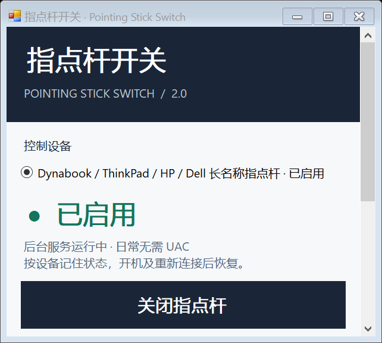

# PointingStickSwitch · 指点杆开关

[](https://github.com/Yifan0718/PointingStickSwitch/actions/workflows/windows.yml)
[](LICENSE)

Windows 指点杆的一键开关：首次安装后日常操作无需 UAC，按设备记住状态，并创建桌面快捷方式。按硬件接口识别，不限制笔记本商品名、销售地区或整机品牌。

**[下载单文件安装程序](https://github.com/Yifan0718/PointingStickSwitch/releases/latest)** · [兼容性与资料](docs/compatibility.md) · [验证说明](docs/testing.md) · [更新记录](CHANGELOG.md)

## 安装和使用

1. 从 Releases 下载 `PointingStickSwitch-Setup-2.0.1.exe`。适用于 Windows 10 1703+ / Windows 11，x86 或 x64，要求 .NET Framework 4.8。ARM64 尚未验证。
2. 运行安装程序并完成一次管理员授权。安装包同时包含主程序、32 位厂商接口辅助程序、后台服务和说明，不捆绑厂商驱动。
3. 打开桌面的「指点杆控制面板」。只有一个兼容设备时自动选择；多个设备时先选定目标。
4. 使用桌面的「一键切换指点杆」，或者控制面板的启用 / 关闭按钮。

没有兼容接口时可以导出诊断；程序不会按“鼠标”名称猜测后禁用设备。旧版 AccuPointSwitch 可原地升级，服务名和安装目录沿用旧值。

本版未进行 Authenticode 代码签名。下载资产附 SHA-256 校验清单；校验和用于核对文件完整性，不替代发行者签名。

```powershell
Get-FileHash .\PointingStickSwitch-Setup-2.0.1.exe -Algorithm SHA256
```

## 支持范围

| 接口 | 当前证据 |
| --- | --- |
| Dynabook / Toshiba AccuPoint 独立 HID Col05 | X30L-J / TOSB1008 本机实测；其他已列出 ID 经资料与模拟验证 |
| ThinkPad 独立 TrackPoint、早期 IBM3780 | 官方驱动模型映射与正反例测试，待对应实机验证 |
| HP ELAN Col05、Dell ALPS Col03 PointStick | 官方驱动模型映射与正反例测试，待对应实机验证 |
| 5 个 Lenovo 外接 TrackPoint 键盘产品 ID | 限鼠标集合，规则测试通过；Windows 外接实机待验证 |
| Synaptics 类型 4/5 逻辑指点杆 | 本机 64 位 SynCOM 实测；其他驱动与连接类型经过策略模拟 |

这是多接口控制程序，**不承诺所有指点杆均兼容**。官方 INF 中的 167 条模型行对应 98 个规范化独立接口标识，不代表 167 台实机。旧 ALPS 共享 PS/2、未知设备、未证实独立接口的 TEX / HHKB / Fujitsu 等设备保留诊断模式。详细 ID、来源和边界见[兼容性文档](docs/compatibility.md)。

## 状态恢复与权限

- 独立 PnP 接口通过 LocalSystem 服务操作。固定本地协议只接受已确认设备标识，客户端验证服务 PID，网络登录无权连接。
- PnP 偏好按设备实例保存，服务启动、唤醒与运行中定期核对。设备移除后保留偏好；重新配对或换端口导致实例变化时须重新选择。
- Synaptics COM 仅在普通用户隔离进程中运行，不由 SYSTEM 加载。偏好按用户保存，登录后约 30 秒内恢复；不保证登录屏幕前生效。
- 已选择的设备消失时不会转而控制其他设备。卸载前需接回已关闭设备，并在各用户账户恢复 Synaptics 逻辑指点杆。
- 无遥测、自动上传或自动下载驱动。导出的诊断包含硬件型号和驱动资料，请检查后再主动提交。

## 构建与测试

源码为 C# / WinForms / .NET Framework 4.8，使用系统 Framework 编译器，不需要 NuGet。Windows PowerShell 5.1 和 PowerShell 7 均可运行脚本。

```powershell
.\src\build.ps1
.\scripts\verify.ps1
.\src\build-installer.ps1 -IsccPath 'C:\Program Files (x86)\Inno Setup 6\ISCC.exe'
```

构建产物在 `artifacts/bin/`，安装包在 `artifacts/release/`，验证结果在 `artifacts/tests/`。发布构建使用 Inno Setup 6.7.3。版本号统一维护在 `src/Version.cs`。

自动测试不会改变物理设备状态：直接运行生产策略、模拟故障，在真实 Windows 管道上测试 IPC，并只读枚举本机设备。x64/x86 各 13,670 项断言；另有 24 组 100%–300% 字体 / 控件布局检查。布局检查不等于真实显示器间 DPI 切换测试。实机与安装测试记录按版本保存在 `evidence/`，2.0.0 记录不能视作 2.0.1 的安装实测。

```text
src/         应用、服务、接口策略、安装脚本
tests/       硬件资料夹具与回归测试
scripts/     完整验证、构建工具和发布打包
docs/        兼容性、资料出处和测试说明
evidence/    按版本保留的验证结果
licenses/    第三方许可证
```



上图使用长名称模拟数据检查布局，不代表在图中列出的所有品牌上实测。

## English

A Windows pointing-stick switch with desktop shortcuts, persistent per-device state and routine operation without UAC after installation. It uses verified independent PnP interfaces or a vendor-provided Synaptics logical-stick API. Identification is based on device interfaces, not laptop marketing names. The application UI is currently Simplified Chinese; the installer also offers English and Japanese.

This is **not a universally validated driver**. The compatibility table distinguishes local hardware tests from official driver evidence and simulations. Shared or unknown input interfaces are not disabled speculatively. See [testing](docs/testing.md) before interpreting test counts as device coverage.

## 许可与贡献

项目使用 [MIT](LICENSE) 许可；第三方材料遵循其各自许可，见 [THIRD-PARTY-NOTICES](THIRD-PARTY-NOTICES.md)。品牌名称仅用于描述兼容性，没有厂商背书。新增硬件请遵循 [CONTRIBUTING](CONTRIBUTING.md)。
